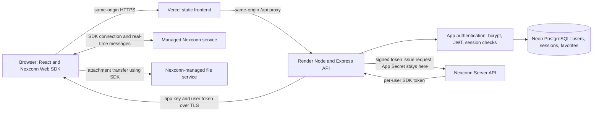
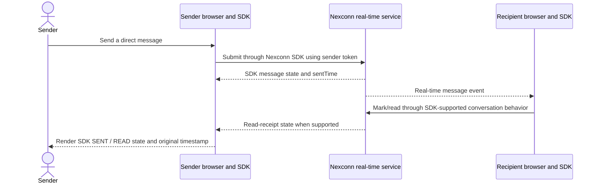
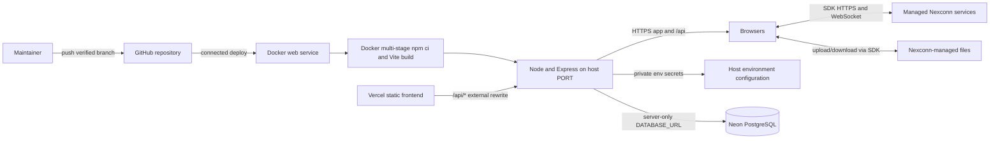
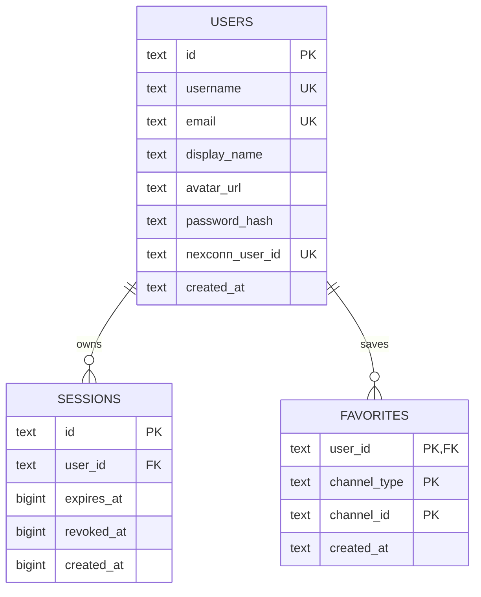

# Nexconn Chat

Nexconn Chat is a responsive web application for account-based direct messaging, powered by the Nexconn Chat UI Web SDK. The app provides its own registration and login, user discovery, persisted favorites, and a Nexconn-backed real-time conversation experience.

## Project status

| Area | Status |
| --- | --- |
| App accounts, password hashing, sessions, logout | Implemented; API tests included |
| Direct conversations and real-time message transport | Nexconn SDK integration implemented; live account verification required |
| Conversation list search, loaded-message search, All/Unread/Favorites filters | Implemented; message search is limited to messages loaded by the SDK |
| Favorites | Persisted per app account in PostgreSQL; direct and existing group conversations |
| Attachments, voice messages, image/PDF previews | Nexconn SDK flow integrated; end-to-end operation requires live Nexconn accounts |
| Responsive UI | Desktop and mobile rules are implemented; recheck target devices in a browser before release |
| Calls and group creation | Removed from this product scope |
| Production hosting / public URL | URLs are live; the changes in this workspace are not deployed yet |

## Technology and architecture

- TypeScript, React 18, Vite 6
- Node.js 20+, Express 5, Helmet, `express-rate-limit`
- PostgreSQL through `pg`; SQLite retained only for the migration importer; bcryptjs hashes and signed JWT in an HttpOnly cookie
- Nexconn Chat, Chat UI, and Engine packages pinned to `26.2.0`
- npm, Docker, Node's built-in test runner

The browser uses a same-origin Express API. The server owns application authentication and signs the Nexconn token-issue request with the App Secret. The browser receives only the signed-in Nexconn user's access token because the Web SDK needs it; this user-scoped bearer token stays in memory in app code. The App Secret and app-session JWT are never returned to the browser.

### A. System architecture



### B. Authentication and SDK connection lifecycle

```mermaid
sequenceDiagram
  actor User
  participant UI as React browser
  participant API as Express API
  participant DB as PostgreSQL
  participant NX as Nexconn Server API
  participant SDK as Nexconn Web SDK
  User->>UI: Register or sign in
  UI->>API: POST /api/auth/register or /api/auth/login
  API->>DB: Verify bcrypt hash; create user session
  API->>NX: Sign and send user-token request with server App Secret
  NX-->>API: User-scoped token and identity
  API-->>UI: HttpOnly app cookie plus SDK config/token
  UI->>SDK: Initialize Chat UI once; connect with SDK token
  SDK-->>UI: Connection result and matching Nexconn identity
  UI->>API: GET /api/auth/session on reload
  API->>DB: Verify JWT and non-revoked session row
  UI->>SDK: Reconnect using a newly issued user token if needed
  User->>UI: Log out
  UI->>API: POST /api/auth/logout
  API->>DB: Revoke server-side session
  UI->>SDK: Disconnect and clear account UI
```

### C. Real-time message and receipt flow



The application does not mirror message bodies, receipts, attachment bytes, or chat history into PostgreSQL. There is no distinct delivered tick in the SDK state used by this app.

### D. Deployment architecture



The Render API uses Neon PostgreSQL for durable state; it does not store production data on Render's ephemeral filesystem and requires no Render disk. Vercel keeps browser API calls same-origin and proxies `/api/*` to Render.

## Repository layout

```text
.
├── licenses/                   Nexconn SDK license and notices
├── public/                     Brand assets and local SVG controls
├── scripts/
│   ├── audit-secrets.js        Secret/build audit without printing values
│   ├── patch-nexconn-chatui.js Guarded postinstall patches for SDK 26.2.0
│   ├── prepare-db-migration.js Consistent SQLite snapshot preparation
│   └── import-sqlite-to-postgres.js Verified transactional SQLite importer
├── server/
│   ├── app.js                  Express security middleware and API routes
│   ├── database.js             PostgreSQL pool, transactions, and versioned migrations
│   └── migrations/             Versioned PostgreSQL schema
│   ├── nexconn.js              Server-side signed Nexconn token issuance
│   └── index.js                Environment validation and server startup
├── src/
│   ├── lib/                    SDK lifecycle, API helpers, filters and theme
│   ├── pages/                  Login and chat screens
│   └── styles/                 Responsive application styles
├── test/                       API, SDK patch, date and lifecycle tests
├── Dockerfile                  Build and non-root runtime image
├── vercel.json                 Same-origin API proxy to the Render service
├── PROJECT_AUDIT.md            Audit checklist and verification status
├── SECURITY_AUDIT.md           Credential findings and rotation guidance
└── vite.config.ts              Dev server, same-origin API proxy, build chunks
```

`data/`, `.env`, `node_modules/`, `dist/`, and SQLite files are excluded from Git and the Docker build context. `DATABASE_URL` is server-only and is never provided to Vite. SDK patching is reproducible through the npm `postinstall` script; do not edit the installed vendor bundle as the only copy of a fix.

## Requirements and setup

- Node.js 20 or newer (Docker uses Node 22)
- npm
- A Neon PostgreSQL development database (use a separate branch/database from production)
- A Nexconn application with its server-side App Key and App Secret, and the matching regional API base URL and area code

Install and prepare local configuration:

```powershell
npm ci
Copy-Item .env.example .env
```

Set `DATABASE_URL` to the **pooled** connection string for your development Neon branch. Do not paste a production URL into a shared shell or use a `VITE_` prefix. Generate a development JWT secret with:

```powershell
node -e "console.log(require('node:crypto').randomBytes(48).toString('base64url'))"
```

Never use a `VITE_` prefix for credentials. The `.env.example` values are placeholders, not working credentials.

### Environment variables

| Variable | Required | Meaning |
| --- | --- | --- |
| `NODE_ENV` | Production | Use `production` for the deployed server; defaults to development. |
| `PORT` | Host-provided | Express listen port. Defaults to `3001` locally; Docker binds `3001`, and a host may inject its own port. |
| `APP_ORIGIN` | Yes | Exact browser origin, with no path. Local Vite: `http://localhost:5173`; production must be the public HTTPS origin. |
| `JWT_SECRET` | Yes | Random application-session signing secret, minimum 32 characters. Keep stable across restarts. |
| `DATABASE_URL` | Yes | Server-side PostgreSQL pooled connection string. Use the Neon connection details with pooling enabled and SSL required. Never expose it to Vite or the browser. |
| `TRUST_PROXY_HOPS` | Proxy-dependent | `0` by default. Set to the exact trusted proxy hop count only when the host topology is known (often `1` behind a single managed proxy); this controls client IP handling for rate limits. |
| `NEXCONN_APP_KEY` | Yes | Nexconn app identifier used by the server request and SDK initialization. |
| `NEXCONN_APP_SECRET` | Yes | Privileged signing secret; server only. Never expose it to the client or logs. |
| `NEXCONN_API_BASE_URL` | Yes | HTTPS Nexconn regional API origin, e.g. the Singapore origin shown in `.env.example`. |
| `NEXCONN_AREA_CODE` | Yes | Matching SDK region code; example is `SG`. |

The app intentionally has no third-party object-storage variables or app-level upload endpoint; the Web SDK transfers attachments through Nexconn's media flow. The Vercel frontend uses same-origin `/api/*` requests, which `vercel.json` rewrites to Render. No `VITE_API_BASE_URL` is needed.

## Run, test and build

```powershell
npm run dev             # Vite at :5173 and Express at :3001
npm test                # Node built-in test runner
npx tsc --noEmit        # TypeScript check
npm run build           # Production frontend bundle in dist/
npm audit              # Full dependency advisory report
npm audit --omit=dev --audit-level=moderate
npm run audit:secrets   # Check configured secret-like values against client output
npm run db:prepare-migration -- --source <verified-copy.sqlite> --snapshot <private-snapshot.sqlite>
npm run db:import-sqlite-to-postgres -- --source <verified-snapshot.sqlite> --target-env DATABASE_URL
npm start               # Start the Express server
```

Tests run against isolated PGlite PostgreSQL instances and do not read `.env` or connect to Neon. There is no lint or formatter script configured. Production startup fails fast unless `DATABASE_URL`, `JWT_SECRET`, an exact HTTPS `APP_ORIGIN`, HTTPS Nexconn API URL, and Nexconn server credentials are provided. `npm start` serves the API and built frontend on one origin.

## Authentication, authorization and API

App passwords are bcrypt-hashed (cost 12). Usernames are 3–24 ASCII letters, digits, dots, underscores, or hyphens. Passwords are 10–72 UTF-8 bytes. Registration/login attempts are rate limited per detected client IP. Production proxy hops must be configured correctly or all visitors behind one reverse proxy may share the same limiter identity.

The app JWT is HS256, seven days, with issuer/audience validation and a corresponding server-side session record. The cookie is HttpOnly, SameSite Strict, Secure in production. Mutating requests require the configured Origin and reject `Sec-Fetch-Site: cross-site`. Protected handlers derive user identity from the verified session; they do not trust a browser-supplied account ID. Logout revokes the server row and clears the cookie. Nexconn identity token issuance is a separate server responsibility and does not reuse the app JWT.

| Method and path | Auth | Purpose |
| --- | --- | --- |
| `GET /api/health` | No | Liveness endpoint (`{ "ok": true }`) |
| `POST /api/auth/register` | No; rate limited | Create account and issue app/Nexconn sessions |
| `POST /api/auth/login` | No; rate limited | Verify account and issue sessions |
| `GET /api/auth/session` | Optional cookie | Restore an authenticated account and issue SDK connection token |
| `POST /api/auth/logout` | Cookie if present | Revoke session and clear cookies |
| `GET /api/users?search=...` | Yes | Search registered users for direct conversations |
| `PUT /api/account/profile` | Yes | Update the signed-in account profile |
| `POST /api/users/profiles` | Yes | Resolve Nexconn profile names for channel members |
| `GET /api/favorites` | Yes | List this account's favorite channels |
| `POST /api/favorites` | Yes | Save direct/group channel favorite |
| `DELETE /api/favorites` | Yes | Remove direct/group channel favorite |

Nexconn App Secret signing and upstream token validation stay server-side. The SDK needs a per-user Nexconn access token in the browser; it is held in memory by app code, but remains accessible to code/extensions running in that page. Nexconn token validity is controlled by the Console and must be set to a finite duration before production. See [`PROJECT_AUDIT.md`](PROJECT_AUDIT.md) for the audit checklist and [`SECURITY_AUDIT.md`](SECURITY_AUDIT.md) for exposure findings and recommended rotations; values are deliberately redacted.

## Database and schema lifecycle

`server/database.js` connects to PostgreSQL through a bounded `pg.Pool` using server-only `DATABASE_URL`. It applies versioned SQL files from `server/migrations/` in a transaction and serializes concurrent startup migrations with a database lock row.

- `users`: text ID, case-insensitive unique username/email indexes, display name/avatar defaults, bcrypt hash, unique Nexconn user ID, and original ISO timestamp text.
- `sessions`: text ID, user foreign key with cascade delete, and epoch-millisecond expiry/revocation/creation values stored as `BIGINT`.
- `favorites`: user foreign key with cascade delete, channel-type and channel-length checks, original timestamp text, and composite primary key `(user_id, channel_type, channel_id)`.

Message history, read receipts, and attachment bytes remain Nexconn-managed; this database has no app-side copies. Existing SQLite files are imported only by `scripts/import-sqlite-to-postgres.js`. The importer makes a consistent online snapshot, never writes to the source, imports users and favorites in one transaction, excludes sessions, refuses a non-empty destination, checks row values/constraints/foreign keys, and rolls back on any conflict. It never guesses which SQLite file is authoritative.

### Prepare and import an authoritative SQLite snapshot

First verify in the Render Dashboard/Shell which mounted SQLite database the currently running service uses. Create a protected backup from that exact source using SQLite's online backup API, then verify the backup path, integrity check, foreign keys, and expected account/favorite counts. Do not use a local workspace SQLite file unless it has been proven to be the same current source. Keep the original and backup unchanged.

To create a migration copy from a verified SQLite file:

```powershell
npm run db:prepare-migration -- --source <verified-production-copy.sqlite> --snapshot <private-snapshot.sqlite>
```

Use the Neon **pooled** URL for a dedicated development branch first. Set that target explicitly in the shell as `TEST_DATABASE_URL` (do not use the production variable), then run:

```powershell
npm run db:import-sqlite-to-postgres -- --source <private-snapshot.sqlite> --target-env TEST_DATABASE_URL
```

After verifying rows and existing-user login on the isolated target, schedule a maintenance window, take a final fresh snapshot from the confirmed production SQLite source, and import that snapshot once into an empty Neon production database. Existing users retain their IDs and password hashes and can sign in again; app sessions are intentionally not carried over. Keep the SQLite source and encrypted backup as immutable rollback evidence. Production import is a manual cutover step and was not run by this code change.



## Messaging, favorites, search and files

The SDK owns Nexconn connection, real-time message send/receive, message history, timestamps, and supported read receipts. The displayed timestamp comes from the SDK's message `sentTime`. The UI uses SDK `SENT` and receipt-backed `READ` states; it does not fake a delivered status. Existing direct and group channels may be favorited. Favorites persist in PostgreSQL per Nexconn Chat account; All lists supported channels once, and Favorites filters to saved channels. Search within a conversation covers messages the SDK has loaded, not an unbounded server-side index.

The app supports direct conversations, text, voice messages, images and files. Attachments are selected in the SDK composer, uploaded with Nexconn's file uploader, and stored by Nexconn. The SDK provides the recipient with its download flow; the app listens to the documented UI download event and calls `Message.downloadMedia()`. Images and PDF may preview when the browser and SDK response permit; other files use attachment download. Newly uploaded PDFs request inline disposition. Signed media links can expire; this SDK integration has no verified URL-refresh mechanism, so an expired link needs a renewed message/link from Nexconn. SDK constraints currently reject empty files and files above 100 MiB in the UI error path. Real upload, receiver download, expired-link and preview checks require two connected live Nexconn accounts.

The guarded `postinstall` patch is pinned specifically to `@nexconn/chatui@26.2.0`. It fixes the app's mobile breakpoint, timestamp/date formatting and footer placement, SDK file type/uploader references, PDF disposition and generated form IDs. It also removes SDK debug lines that logged raw message data. The patch throws when expected SDK internals change; review it before upgrading SDK versions.

## Security, logging and reliability

- `.env`, local data, build output, dependency folders, logs, and SQLite files are ignored; `.env.example` contains placeholders only.
- Helmet configures CSP/security headers; scripts are same-origin, while inline styles remain allowed for SDK web-component rendering.
- Express limits JSON request bodies to 32 KiB. API errors are sanitized. Browser diagnostics expose selected status codes/booleans only; production diagnostics are disabled. SDK log level is errors only.
- `npm run audit:secrets` scans app source and production assets against configured sensitive environment values without printing those values.
- The container runs as the unprivileged `node` user and has a health check. `SIGTERM`/`SIGINT` closes the HTTP server and PostgreSQL pool.
- Don't mount a public database directory, put credentials in image build args, or share production App Secret values in support tickets.
- Review [`SECURITY_AUDIT.md`](SECURITY_AUDIT.md) and rotate credentials marked as potentially exposed before a public launch.

## Verification and known limits

The test suite covers PostgreSQL-backed registration/login, hash storage, duplicate accounts, two-user discovery, protected identity, expired/revoked sessions, CSRF origin checks, per-user favorites, migrations, transaction rollback, SQLite importer integrity and retry safety, and mocked Nexconn token signing. Database tests use isolated PGlite PostgreSQL instances and do not connect to Neon. SDK patch tests inspect the installed 26.2.0 package. Tests do not connect to Nexconn or verify real attachment transfer.

Known operational limits: no app-level mirrored chat history; search is restricted to loaded SDK history; no explicit delivered tick; token validity is a Console setting; expired attachment URLs cannot be refreshed here; Neon Free may suspend compute and has usage limits; no lint/formatter tooling. The production build currently warns that the SDK Engine chunk is about 860 kB minified (about 179 kB gzip); the application keeps SDK loading on the authenticated chat path and does not suppress the build warning.

## Production deployment: Vercel frontend, Render Free API, Neon Free PostgreSQL

### Architecture

Vercel serves the static Vite frontend and preserves the existing /api/* rewrite to https://nexconn-chat.onrender.com. Render runs the Dockerized Express API. Neon stores users, password hashes, app sessions, and favorites through a pooled PostgreSQL DATABASE_URL. The app does not persist production state on Render temporary storage; no Render disk is needed. Nexconn continues to own message history and media.

### Set up Neon

1. Create a Neon Free project in a region reasonably close to the Render service. Use a dedicated development branch/database separate from production.
2. In Neon connection details, enable the pooled connection option. Store the resulting PostgreSQL URL with SSL required as DATABASE_URL. Keep it server-side; never put it in Vite variables, frontend source, or browser storage.
3. The service applies versioned schema migrations on startup. Do not manually create duplicate app tables. Take a Neon backup/branch before production data import.

Neon Free has usage/storage limits and can suspend its compute when idle. The first request after idle may have extra latency. Check Neon's current dashboard limits before launch; the free plan is not an always-on SLA.

### Configure Render Free

1. Open the existing nexconn-chat Render web service. Select the repository Dockerfile runtime, Docker context/repository root, and health check path /api/health.
2. Keep the service on the Free instance plan. Do not add a disk. Render injects PORT.
3. Set these variables under the service Environment settings. Enter secrets directly in Render; do not paste their values into source or chat.

   | Key | Value |
   | --- | --- |
   | NODE_ENV | production |
   | APP_ORIGIN | https://nexconn-chat.vercel.app |
   | DATABASE_URL | Neon pooled PostgreSQL URL with SSL required |
   | JWT_SECRET | Private random value, at least 32 characters |
   | NEXCONN_APP_KEY | Existing Nexconn App Key |
   | NEXCONN_APP_SECRET | Existing Nexconn App Secret, server-side only |
   | NEXCONN_API_BASE_URL | Existing HTTPS Nexconn regional API origin |
   | NEXCONN_AREA_CODE | Matching region code |
   | TRUST_PROXY_HOPS | Keep 0 unless Render's trusted proxy hop count has been verified |

4. Deploy only after the production SQLite source and migration snapshot are verified. Confirm logs contain the generic startup message and no credential or connection string. Render Free services may spin down when idle; this is separate from Neon compute suspension.

### Configure Vercel

Keep the Vite preset, repository root, build command npm run build, and output directory dist. Preserve vercel.json's /api/:path* rewrite to Render. Do not set DATABASE_URL or a database/API secret in Vercel. After deployment, Vercel health requests should be proxied to Render and return the API health response.

### Verify the authoritative SQLite source before cutover

Do not assume data/nas-on.sqlite, data/nexconn-live-migration.sqlite, or any other local file is the production source. Before migration:

1. In the Render Dashboard, inspect the currently deployed service, its deployed commit, and the environment variable name DATABASE_PATH (do not copy secrets). Check the service storage configuration and the running version startup logs to establish which database path it opened.
2. If a persistent volume is attached, verify its mount path and identify the SQLite file under that mount. If no volume exists, determine whether the current file is on ephemeral service storage and whether the service has restarted since its last known write. Do not proceed if the data authority or completeness is uncertain.
3. Schedule a maintenance window and stop account/favorite writes. Use the currently running service authorized Shell or an approved secure file-transfer method to create a SQLite online backup from that exact file. Never copy only the live SQLite file while WAL writes are active.
4. Run read-only checks on the backup: PRAGMA integrity_check must return ok; PRAGMA foreign_key_check must return no rows; record users/favorites counts and confirm representative IDs/timestamps without printing password hashes. Keep the original untouched and store an encrypted backup outside the service.
5. Make the verified snapshot available to the migration command in a private path. If Render Free does not provide a secure Shell/transfer route for the file, stop and choose an approved private transfer method; do not expose a temporary public download endpoint.

Prepare a migration copy from a verified SQLite file by running:

    npm run db:prepare-migration -- --source <verified-production-copy.sqlite> --snapshot <private-snapshot.sqlite>

### Test and cut over

First test on an isolated Neon development branch. Set its pooled URL as TEST_DATABASE_URL; never use the production URL for this rehearsal:

    npm run db:import-sqlite-to-postgres -- --source <private-snapshot.sqlite> --target-env TEST_DATABASE_URL

The importer requires explicit source and target selection, refuses a non-empty app database, snapshots SQLite consistently, keeps the source unchanged, imports users/favorites transactionally, excludes sessions, and verifies every imported field, counts, uniqueness, and relationships. Password hashes are passed only as database parameters and are never logged. Re-running against a populated target is rejected without changing its rows.

For production cutover, perform a second fresh snapshot after writes are paused, back up the Neon target, and import exactly once into the empty production database using the same command with --target-env DATABASE_URL. Then deploy the PostgreSQL runtime and verify:

1. https://nexconn-chat.onrender.com/api/health returns HTTP 200 and {"ok":true}.
2. https://nexconn-chat.vercel.app/api/health returns the same response through the existing rewrite.
3. An existing user can sign in with the old password; verify the account ID and favorites are preserved. Sessions are intentionally not imported, so all users sign in again.
4. Register/login/logout, profiles, user search, favorites, Nexconn connection, and two-account real-time messaging work.
5. Redeploy/restart the Render service and confirm account/favorite data remains in Neon. Also test after Neon has idled so cold-start behavior is understood.

Do not cut over while writes are active between the final snapshot and the new app accepting traffic. The current source and backup should remain read-only and retained after launch.

### Rollback and cost limits

For application rollback after cutover, redeploy a PostgreSQL-compatible application version and restore Neon from the verified backup/branch if necessary. Keep the SQLite source as a separate encrypted archive. Do not switch the Free Render service back to SQLite on its ephemeral filesystem; it cannot provide durable SQLite persistence without a persistent disk. Any recovery of writes made after the snapshot must be planned explicitly.

This plan uses Render Free without a disk and Neon Free. It has no paid Render persistence requirement, but Free services/databases have usage limits, idle suspension, possible cold starts, and no production availability guarantee. Verify current plan terms and capacity in each dashboard before inviting users. No production data has been imported, and no service environment variable or deployment has been changed by this code work.
## GitHub setup and maintenance

The Git repository is connected to `origin` on branch `main`. Changes in this workspace are not automatically deployed or pushed. Before a release, review the exact diff, stage only intended files, and verify the configured remote/branch:

```powershell
git remote -v
git branch --show-current
git status --short
```

Do not add `.env`, `data/`, `node_modules/`, or `dist/`. Keep deployment credentials only in the host's secret manager. These code changes have not been committed, pushed, or deployed.

## Troubleshooting

| Symptom | Check |
| --- | --- |
| App rejects register/login with Origin error | Make `APP_ORIGIN` match the browser origin exactly, including scheme and port. |
| Production server exits immediately | Set a valid server-side Neon PostgreSQL `DATABASE_URL`, exact HTTPS `APP_ORIGIN`, HTTPS Nexconn API URL, `JWT_SECRET`, and both Nexconn server credentials. |
| Rate limit seems shared by every user in production | Check the real reverse-proxy topology and set `TRUST_PROXY_HOPS` to the verified hop count; do not trust arbitrary forwarded headers. |
| User sees “messaging not configured” | Check App Key/Secret privately in server environment and ensure API base URL and area code are the same region. Never paste the secret into browser variables. |
| Account opens but no channels appear | Confirm SDK identity matches the app account, check the Nexconn Console's user/channel permissions, and inspect sanitized development events. |
| Second login in the same page fails | The SDK UI is a page-lifetime singleton; use the existing `prepareNexconn`/disconnect flow and do not destroy/reinitialize it manually. |
| File sends but will not open | Check SDK upload result and receiver permission, URL freshness, browser-supported preview format and SDK media-link response. Resend if the remote URL expired. |
| Database connection fails after deploy | Check the Render-only `DATABASE_URL`, use Neon's pooled connection string with SSL required, and verify the Neon project/branch is active and within plan limits. Never paste the URL into logs or tickets. |
| Vite cannot reach the API | Confirm Express port equals `PORT` and Vite's `/api` proxy target in `vite.config.ts`. |
| Vercel returns `404 NOT_FOUND` for `/api/...` | Deploy `vercel.json` and confirm its external rewrite points to the current Render service URL. |

## Contributions and future improvements

Before changing SDK behavior, inspect the exact pinned package types and documentation, then update the guarded patch and its tests together. Do not log tokens, auth payloads or message bodies. Suggested next steps are authoritative production SQLite verification and staged Neon rehearsal, then live two-account attachment and mobile-browser verification.

## SDK licenses

Nexconn SDK licenses and notices are retained under [`licenses/`](licenses/). Review the terms before publishing or redistributing this repository. The package is currently private in `package.json`; publishing source to a private GitHub repository does not itself change npm package visibility.
