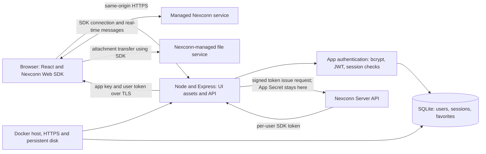
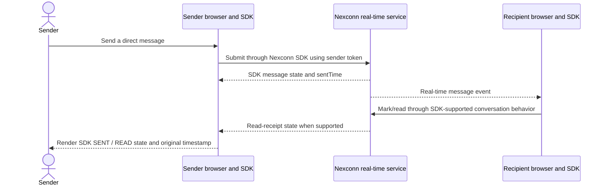
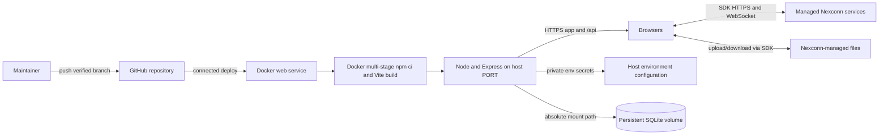
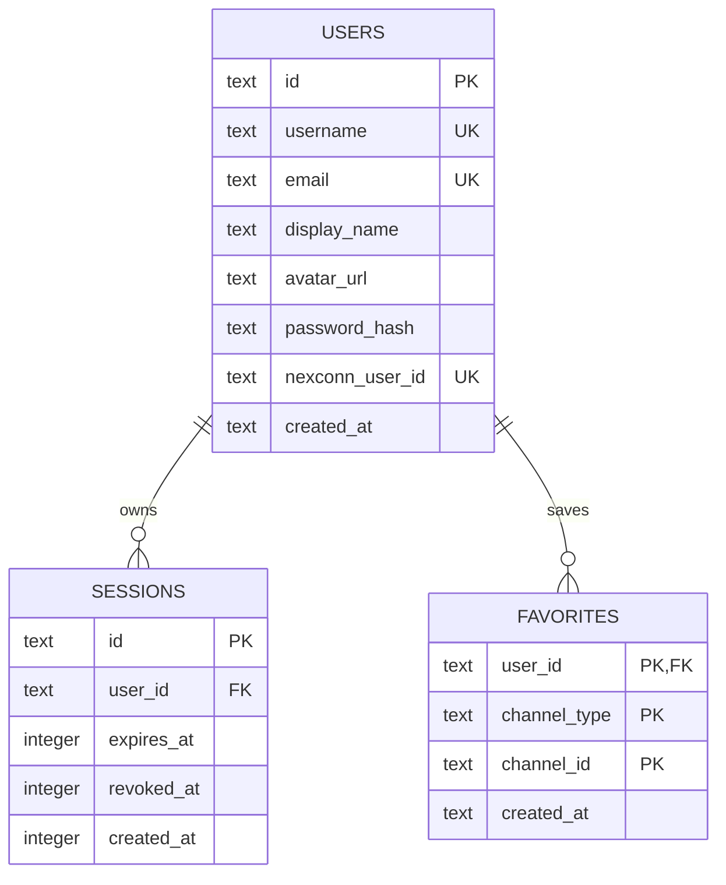

# Nexconn Chat

Nexconn Chat is a responsive web application for account-based direct messaging, powered by the Nexconn Chat UI Web SDK. The app provides its own registration and login, user discovery, persisted favorites, and a Nexconn-backed real-time conversation experience.

## Project status

| Area | Status |
| --- | --- |
| App accounts, password hashing, sessions, logout | Implemented; API tests included |
| Direct conversations and real-time message transport | Nexconn SDK integration implemented; live account verification required |
| Conversation list search, loaded-message search, All/Unread/Favorites filters | Implemented; message search is limited to messages loaded by the SDK |
| Favorites | Persisted per app account in SQLite; direct and existing group conversations |
| Attachments, voice messages, image/PDF previews | Nexconn SDK flow integrated; end-to-end operation requires live Nexconn accounts |
| Responsive UI | Desktop and mobile rules are implemented; recheck target devices in a browser before release |
| Calls and group creation | Removed from this product scope |
| Production hosting / public URL | Not deployed from this workspace |

## Technology and architecture

- TypeScript, React 18, Vite 6
- Node.js 20+, Express 5, Helmet, `express-rate-limit`
- SQLite through `better-sqlite3`; bcryptjs password hashes; signed JWT in an HttpOnly cookie
- Nexconn Chat, Chat UI, and Engine packages pinned to `26.2.0`
- npm, Docker, Node's built-in test runner

The browser uses a same-origin Express API. The server owns application authentication and signs the Nexconn token-issue request with the App Secret. The browser receives only the signed-in Nexconn user's access token because the Web SDK needs it; this user-scoped bearer token stays in memory in app code. The App Secret and app-session JWT are never returned to the browser.

### A. System architecture



### B. Authentication and SDK connection lifecycle

```mermaid
sequenceDiagram
  actor User
  participant UI as React browser
  participant API as Express API
  participant DB as SQLite
  participant NX as Nexconn Server API
  participant SDK as Nexconn Web SDK
  User->>UI: Register or sign in
  UI->>API: POST /api/auth/register or /api/auth/login
  API->>DB: Verify bcrypt hash; create user session
  API->>NX: Sign and send user-token request with server App Secret
  NX-->>API: User-scoped token and identity
  API-->>UI: HttpOnly app cookie plus SDK config/token
  UI->>SDK: Initialize Chat UI once; connect with SDK token
  SDK-->>UI: Connection result and matching Nexconn identity
  UI->>API: GET /api/auth/session on reload
  API->>DB: Verify JWT and non-revoked session row
  UI->>SDK: Reconnect using a newly issued user token if needed
  User->>UI: Log out
  UI->>API: POST /api/auth/logout
  API->>DB: Revoke server-side session
  UI->>SDK: Disconnect and clear account UI
```

### C. Real-time message and receipt flow



The application does not mirror message bodies, receipts, attachment bytes, or chat history into SQLite. There is no distinct delivered tick in the SDK state used by this app.

### D. Deployment architecture



The Docker host and disk are deployment infrastructure, not provisioned by this repository. This SQLite architecture is for one app instance. Multiple app replicas need a shared transactional database (for example managed PostgreSQL) and a reviewed schema migration before scaling.

## Repository layout

```text
.
├── licenses/                   Nexconn SDK license and notices
├── public/                     Brand assets and local SVG controls
├── scripts/
│   ├── audit-secrets.js        Secret/build audit without printing values
│   ├── patch-nexconn-chatui.js Guarded postinstall patches for SDK 26.2.0
│   └── prepare-db-migration.js Consistent account-data export for deployment
├── server/
│   ├── app.js                  Express security middleware and API routes
│   ├── database.js             SQLite schema creation and compatibility updates
│   ├── nexconn.js              Server-side signed Nexconn token issuance
│   └── index.js                Environment validation and server startup
├── src/
│   ├── lib/                    SDK lifecycle, API helpers, filters and theme
│   ├── pages/                  Login and chat screens
│   └── styles/                 Responsive application styles
├── test/                       API, SDK patch, date and lifecycle tests
├── Dockerfile                  Build and non-root runtime image
├── PROJECT_AUDIT.md            Audit checklist and verification status
├── SECURITY_AUDIT.md           Credential findings and rotation guidance
└── vite.config.ts              Dev server, same-origin API proxy, build chunks
```

`data/`, `.env`, `node_modules/`, `dist/`, and SQLite files are excluded from Git and the Docker build context. SDK patching is reproducible through the npm `postinstall` script; do not edit the installed vendor bundle as the only copy of a fix.

## Requirements and setup

- Node.js 20 or newer (Docker uses Node 22)
- npm
- A Nexconn application with its server-side App Key and App Secret, and the matching regional API base URL and area code

Install and prepare local configuration:

```powershell
npm ci
Copy-Item .env.example .env
```

Set the local variables in `.env`. Generate a development JWT secret with:

```powershell
node -e "console.log(require('node:crypto').randomBytes(48).toString('base64url'))"
```

Never use a `VITE_` prefix for credentials. The `.env.example` values are placeholders, not working credentials.

### Environment variables

| Variable | Required | Meaning |
| --- | --- | --- |
| `NODE_ENV` | Production | Use `production` for the deployed server; defaults to development. |
| `PORT` | Host-provided | Express listen port. Defaults to `3001` locally; Docker binds `3001`, and a host may inject its own port. |
| `APP_ORIGIN` | Yes | Exact browser origin, with no path. Local Vite: `http://localhost:5173`; production must be the public HTTPS origin. |
| `JWT_SECRET` | Yes | Random application-session signing secret, minimum 32 characters. Keep stable across restarts. |
| `DATABASE_PATH` | Yes | SQLite database file. Local default is `./data/nexconn-chat.sqlite`; production must be an absolute path on persistent storage. |
| `TRUST_PROXY_HOPS` | Proxy-dependent | `0` by default. Set to the exact trusted proxy hop count only when the host topology is known (often `1` behind a single managed proxy); this controls client IP handling for rate limits. |
| `NEXCONN_APP_KEY` | Yes | Nexconn app identifier used by the server request and SDK initialization. |
| `NEXCONN_APP_SECRET` | Yes | Privileged signing secret; server only. Never expose it to the client or logs. |
| `NEXCONN_API_BASE_URL` | Yes | HTTPS Nexconn regional API origin, e.g. the Singapore origin shown in `.env.example`. |
| `NEXCONN_AREA_CODE` | Yes | Matching SDK region code; example is `SG`. |

The app intentionally has no third-party object-storage variables or app-level upload endpoint; the Web SDK transfers attachments through Nexconn's media flow.

## Run, test and build

```powershell
npm run dev             # Vite at :5173 and Express at :3001
npm test                # Node built-in test runner
npx tsc --noEmit        # TypeScript check
npm run build           # Production frontend bundle in dist/
npm audit              # Full dependency advisory report
npm audit --omit=dev --audit-level=moderate
npm run audit:secrets   # Check configured secret-like values against client output
npm run db:prepare-migration # Export local accounts/favorites for a live migration
npm start               # Start the Express server
```

There is no lint or formatter script configured. Do not treat that as a passing lint check. Production startup fails fast unless `JWT_SECRET`, an exact HTTPS `APP_ORIGIN`, HTTPS Nexconn API URL and credentials, and an absolute `DATABASE_PATH` are provided. Keep the SQLite path on a durable volume. `npm start` serves the API and built frontend on one origin.

## Authentication, authorization and API

App passwords are bcrypt-hashed (cost 12). Usernames are 3–24 ASCII letters, digits, dots, underscores, or hyphens. Passwords are 10–72 UTF-8 bytes. Registration/login attempts are rate limited per detected client IP. Production proxy hops must be configured correctly or all visitors behind one reverse proxy may share the same limiter identity.

The app JWT is HS256, seven days, with issuer/audience validation and a corresponding server-side session record. The cookie is HttpOnly, SameSite Strict, Secure in production. Mutating requests require the configured Origin and reject `Sec-Fetch-Site: cross-site`. Protected handlers derive user identity from the verified session; they do not trust a browser-supplied account ID. Logout revokes the server row and clears the cookie. Nexconn identity token issuance is a separate server responsibility and does not reuse the app JWT.

| Method and path | Auth | Purpose |
| --- | --- | --- |
| `GET /api/health` | No | Liveness endpoint (`{ "ok": true }`) |
| `POST /api/auth/register` | No; rate limited | Create account and issue app/Nexconn sessions |
| `POST /api/auth/login` | No; rate limited | Verify account and issue sessions |
| `GET /api/auth/session` | Optional cookie | Restore an authenticated account and issue SDK connection token |
| `POST /api/auth/logout` | Cookie if present | Revoke session and clear cookies |
| `GET /api/users?search=...` | Yes | Search registered users for direct conversations |
| `PUT /api/account/profile` | Yes | Update the signed-in account profile |
| `POST /api/users/profiles` | Yes | Resolve Nexconn profile names for channel members |
| `GET /api/favorites` | Yes | List this account's favorite channels |
| `POST /api/favorites` | Yes | Save direct/group channel favorite |
| `DELETE /api/favorites` | Yes | Remove direct/group channel favorite |

Nexconn App Secret signing and upstream token validation stay server-side. The SDK needs a per-user Nexconn access token in the browser; it is held in memory by app code, but remains accessible to code/extensions running in that page. Nexconn token validity is controlled by the Console and must be set to a finite duration before production. See [`PROJECT_AUDIT.md`](PROJECT_AUDIT.md) for the audit checklist and [`SECURITY_AUDIT.md`](SECURITY_AUDIT.md) for exposure findings and recommended rotations; values are deliberately redacted.

## Database and schema lifecycle

SQLite tables are initialized at server startup in `server/database.js`:

- `users`: app ID, unique case-insensitive username and email, display name/avatar, bcrypt hash, Nexconn user ID, created timestamp.
- `sessions`: random session ID, owner user ID, expiration, revoke timestamp, creation timestamp. Foreign key cascades on account removal.
- `favorites`: owner user ID, `direct` or `group` channel type, channel ID and creation time. Composite primary key prevents duplicates; foreign key cascades with the owner.

Indexes support session and Nexconn user ID lookups. Schema creation and the existing display/avatar compatibility update are idempotent, but this project does not have a versioned migration framework. Back up the database before releases that change schema. The SQLite file uses WAL and a 5-second busy timeout. Run one app instance against a local persistent disk; use managed shared SQL and a formal migration plan before horizontal scaling.

### Preserve existing local accounts when going live

The local SQLite database is ignored by Git and currently resides at `data/nas-on.sqlite`. To prepare a consistent export from the path configured in `.env`, run:

```powershell
npm run db:prepare-migration
```

This writes `data/nexconn-live-migration.sqlite`, reports only row counts and integrity status, preserves account/profile records and favorites, and clears application sessions in the copy. Existing users can sign in with their current username/email and password; they must sign in again because production uses a new `JWT_SECRET`. Nexconn user tokens are issued again during login. The export contains private account data and password hashes: never commit or share it, and keep an encrypted backup until migration is verified.

After a disk-backed Render service is deployed, configure SSH/SFTP and transfer the export to `/data/nexconn-live-migration.sqlite` with Render's documented `scp -s` flow. Change the service's private `DATABASE_PATH` setting to `/data/nexconn-live-migration.sqlite` and restart/redeploy; the app then opens the migrated DB. Render persistent disks and SSH access require a compatible paid service. Do not copy the live `.sqlite` file by itself while WAL writes are active; use this export script's SQLite backup API. Keep one service instance.



## Messaging, favorites, search and files

The SDK owns Nexconn connection, real-time message send/receive, message history, timestamps, and supported read receipts. The displayed timestamp comes from the SDK's message `sentTime`. The UI uses SDK `SENT` and receipt-backed `READ` states; it does not fake a delivered status. Existing direct and group channels may be favorited. Favorites persist in SQLite per Nexconn Chat account; All lists supported channels once, and Favorites filters to saved channels. Search within a conversation covers messages the SDK has loaded, not an unbounded server-side index.

The app supports direct conversations, text, voice messages, images and files. Attachments are selected in the SDK composer, uploaded with Nexconn's file uploader, and stored by Nexconn. The SDK provides the recipient with its download flow; the app listens to the documented UI download event and calls `Message.downloadMedia()`. Images and PDF may preview when the browser and SDK response permit; other files use attachment download. Newly uploaded PDFs request inline disposition. Signed media links can expire; this SDK integration has no verified URL-refresh mechanism, so an expired link needs a renewed message/link from Nexconn. SDK constraints currently reject empty files and files above 100 MiB in the UI error path. Real upload, receiver download, expired-link and preview checks require two connected live Nexconn accounts.

The guarded `postinstall` patch is pinned specifically to `@nexconn/chatui@26.2.0`. It fixes the app's mobile breakpoint, timestamp/date formatting and footer placement, SDK file type/uploader references, PDF disposition and generated form IDs. It also removes SDK debug lines that logged raw message data. The patch throws when expected SDK internals change; review it before upgrading SDK versions.

## Security, logging and reliability

- `.env`, local data, build output, dependency folders, logs, and SQLite files are ignored; `.env.example` contains placeholders only.
- Helmet configures CSP/security headers; scripts are same-origin, while inline styles remain allowed for SDK web-component rendering.
- Express limits JSON request bodies to 32 KiB. API errors are sanitized. Browser diagnostics expose selected status codes/booleans only; production diagnostics are disabled. SDK log level is errors only.
- `npm run audit:secrets` scans app source and production assets against configured sensitive environment values without printing those values.
- The container runs as the unprivileged `node` user and uses a health check. `SIGTERM`/`SIGINT` closes the server and SQLite handle.
- Don't mount a public database directory, put credentials in image build args, or share production App Secret values in support tickets.
- Review [`SECURITY_AUDIT.md`](SECURITY_AUDIT.md) and rotate credentials marked as potentially exposed before a public launch.

## Verification and known limits

The test suite covers app registration/login, hash storage, duplicate accounts, two-user discovery, protected identity, expired/revoked sessions, CSRF origin checks, per-user favorites, and mocked Nexconn token signing. SDK patch tests inspect the installed 26.2.0 package. Tests do not connect to Nexconn or verify real attachment transfer. A local build cannot prove production Console settings, deployed secrets, live media access, or mobile browser behavior. No screenshots are included in this repository.

Known operational limits: no app-level mirrored chat history; search is restricted to loaded SDK history; no explicit delivered tick; token validity is a Console setting; expired attachment URLs cannot be refreshed here; one SQLite-backed service instance; no versioned migrations; no lint/formatter tooling; no public deployment configured yet. The production build currently warns that the SDK Engine chunk is about 860 kB minified (about 179 kB gzip); the application keeps SDK loading on the authenticated chat path and does not suppress the build warning.

## Production deployment with Render (Docker)

Render is a suitable Docker web-service target because this application needs a persistent Node process, one same-origin API/UI service, and durable writable storage for SQLite. Render web services support Docker, custom domains, environment variables and health checks; its filesystem is ephemeral unless a persistent disk is attached. A disk-backed SQLite service should run as one instance. Review the current [Render Docker guide](https://render.com/docs/docker), [web services guide](https://render.com/docs/web-services), [persistent disks guide](https://render.com/docs/disks), and [health checks guide](https://render.com/docs/health-checks) before provisioning; plan availability and cost according to Render's current plans.

### Deploy steps

1. Create a GitHub repository and push this project (see GitHub setup below).
2. In Render, select **New → Web Service**, connect the GitHub repository and choose the intended branch.
3. Select **Docker** as the runtime. Keep the repository's `Dockerfile`; no build/start override is needed.
4. Set health check path to `/api/health`. The container binds `0.0.0.0` using `PORT`.
5. Add a persistent disk mounted at `/data`; initially use `DATABASE_PATH=/data/nexconn-chat.sqlite`. Disk-backed services have deployment availability trade-offs; review Render's current disk documentation.
6. Add private environment values in the Render service settings: `NODE_ENV=production`, `APP_ORIGIN=https://<your-service>.onrender.com` (change after setting a custom domain), `JWT_SECRET` (random, at least 32 characters), `DATABASE_PATH=/data/nexconn-chat.sqlite`, `TRUST_PROXY_HOPS=1` only if one trusted proxy hop is confirmed, `NEXCONN_APP_KEY`, `NEXCONN_APP_SECRET`, `NEXCONN_API_BASE_URL`, and `NEXCONN_AREA_CODE`. Keep all credentials in secret settings, never in the repo or Docker build args.
7. Transfer `data/nexconn-live-migration.sqlite` into `/data` through the secure migration steps above, change `DATABASE_PATH` to that file, and restart. Verify an existing account can sign in, then check health, register two test accounts, connect both SDK sessions, exchange a text message and attachment, refresh, log out/in, and confirm persistence. Verify App Secret and finite user-token validity in Nexconn Console before inviting real users.
8. For a custom domain, add it in Render, configure the DNS records Render displays, wait for TLS issuance, then set `APP_ORIGIN` to that exact HTTPS origin and redeploy. `APP_ORIGIN` must not include a path or trailing route.
9. Back up the SQLite volume on an operational schedule and test restore. Monitor Render deploy logs and health status; never include request bodies or tokens in logs.

This repository does not contain Render account access, a connected GitHub remote, production credentials approval, billing approval, or a domain. Therefore no live deployment or public URL is claimed.

## GitHub setup and maintenance

The workspace repository currently has branch `master`, no commits, and no remote. After creating/choosing the intended GitHub repository, configure its exact remote and verify it before the first push:

```powershell
git remote add origin https://github.com/<owner>/<repository>.git
git remote -v
git status --short
```

Review and stage only intended files, inspect `git diff --cached`, run tests/build/security checks, then commit and push the chosen branch. Do not add `.env`, `data/`, `node_modules/`, or `dist/`. No remote or history exists yet, so this README does not prescribe a force push or history rewrite. Once a remote exists, maintain protected mainline branches, review dependency updates, run checks before releases, and keep credentials only in the host's secret manager.

## Troubleshooting

| Symptom | Check |
| --- | --- |
| App rejects register/login with Origin error | Make `APP_ORIGIN` match the browser origin exactly, including scheme and port. |
| Production server exits immediately | Set valid HTTPS `APP_ORIGIN`, HTTPS Nexconn API URL, `JWT_SECRET`, both Nexconn server credentials, absolute persistent `DATABASE_PATH`, and valid `PORT`. |
| Rate limit seems shared by every user in production | Check the real reverse-proxy topology and set `TRUST_PROXY_HOPS` to the verified hop count; do not trust arbitrary forwarded headers. |
| User sees “messaging not configured” | Check App Key/Secret privately in server environment and ensure API base URL and area code are the same region. Never paste the secret into browser variables. |
| Account opens but no channels appear | Confirm SDK identity matches the app account, check the Nexconn Console's user/channel permissions, and inspect sanitized development events. |
| Second login in the same page fails | The SDK UI is a page-lifetime singleton; use the existing `prepareNexconn`/disconnect flow and do not destroy/reinitialize it manually. |
| File sends but will not open | Check SDK upload result and receiver permission, URL freshness, browser-supported preview format and SDK media-link response. Resend if the remote URL expired. |
| Database resets after deploy | Ensure the SQLite path is under the mounted persistent disk and retain one app instance. |
| Vite cannot reach the API | Confirm Express port equals `PORT` and Vite's `/api` proxy target in `vite.config.ts`. |

## Contributions and future improvements

Before changing SDK behavior, inspect the exact pinned package types and documentation, then update the guarded patch and its tests together. Do not log tokens, auth payloads or message bodies. Suggested next steps are live two-account attachment and mobile-browser verification, a versioned migration framework, shared database before multi-instance scaling, and explicit CI lint/format policies after choosing project tooling.

## SDK licenses

Nexconn SDK licenses and notices are retained under [`licenses/`](licenses/). Review the terms before publishing or redistributing this repository. The package is currently private in `package.json`; publishing source to a private GitHub repository does not itself change npm package visibility.
